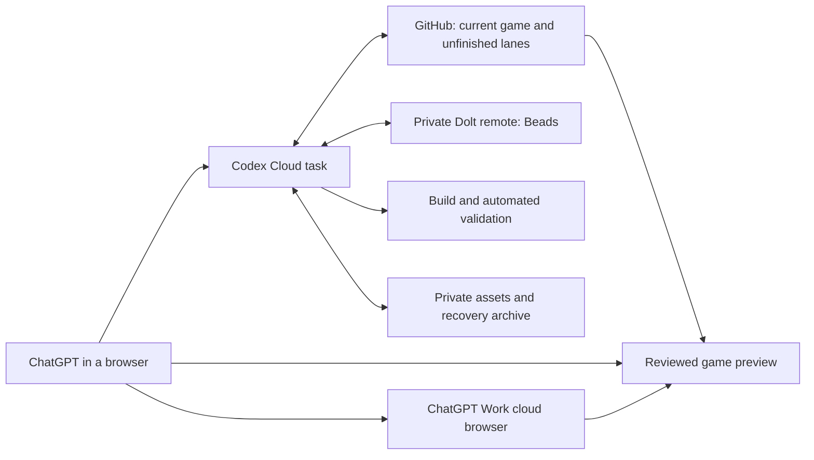

# Codex-Orka migration to ChatGPT cloud

Status: cloud cutover proposal; local checkpoint and commit audit executed under ORKA-dwy. Updated October 9, 2026, America/Los_Angeles.

The requested outcome is to develop Wishfire from ChatGPT in a browser while this Mac is offline. Preserve every unfinished lane, source asset, task record, and recovery checkpoint. The owner authorized local checkpointing and commit management. Cloud move, publication, deployment and retirement remain pending their own go-ahead. The [checkpoint report](chatgpt-cloud-checkpoint-report.md) and [branch audit](chatgpt-cloud-checkpoint-audit.json) record the executed preservation work and current integration gates.

## Recommendation

Checkpoint the whole workspace before integration. Review and merge the approved current work in dependency order, then publish a tested cloud environment backed by GitHub. Retain unfinished lanes as named branches with their own checkpoints. Cloud setup can begin with those lanes still open once their state is safely preserved and remotely accessible.

Use the existing repository and its Git history as the starting design. Choose the destination's visibility before publishing more content: the current repository is public. Keep historical recovery bundles and large reference recordings in private durable storage, outside ordinary development search. Every retained item needs an accessible location and a verified checksum.

The critical path is preservation, integration review, remote publication, Beads portability, environment proof, then cutover. Merging every historical branch would bring retired gameplay contracts into the current game.

## What the cloud move means

The proposed working arrangement is:

OpenAI documents this setup flow: sign in to ChatGPT, choose **Work in > Cloud**, select **Create environment**, connect/select the GitHub repository, run setup, review its results, and publish. Coding tasks then use that environment across web, desktop, and mobile. [Codex Cloud overview](https://learn.chatgpt.com/docs/cloud)

A ChatGPT Project can organize design conversations and selected reference documents. Conversation sync leaves local folders on their original computer. Work with local computer access still needs that computer for its files and tools. Existing local conversations retain their execution mode. Prepare explicit handoffs for new cloud tasks. [Projects and chats](https://learn.chatgpt.com/docs/projects), [Work across devices](https://learn.chatgpt.com/docs/get-started-with-work#continue-work-across-devices)

Cloud environments preserve each task's workspace separately. Repository skills are available; personal local skills require deliberate transfer. Current documentation lists browser/computer use as unsupported. VM storage is 8 GiB on Plus/Edu Plus and 32 GiB on Pro/Business/Enterprise/Edu/Edu Pro. Saved VM recovery defaults to seven days after activity. Install scripts and start skills configure setup. Secrets/network settings need review. Publish or republish changes for new tasks. [Cloud environments](https://learn.chatgpt.com/docs/environments/cloud-environments)

This leaves an acceptance question for a visual game: prove headless browser tests in the environment, provide a durable preview for human review, and retain a route for native art authoring. A successful code task alone cannot establish that every current Mac workflow has moved.

ChatGPT Work also has a separate hosted cloud browser that can visit websites and interact with them, subject to account/workspace availability. Use a Work task to inspect the remotely hosted game preview while Codex Cloud owns repository work. This proposed QA route needs a trial with Wishfire's Canvas rendering and controls. Treat the two tasks as separate environments and pass the preview URL, exact commit, test actions, and findings between them. [ChatGPT Work browser](https://learn.chatgpt.com/docs/browser)

## Verified project state

The companion [inventory](chatgpt-cloud-migration-inventory.json) contains all local branches, registered worktrees, live GitHub heads, open PRs, local tags, task status, and proposed branch dispositions. It records observations made during this planning session. Refresh it before execution.

| Item | Observed state | Consequence |
| --- | --- | --- |
| GitHub repository | `mdtrahan/wishfire-game`, public, default branch `main` | Review publication scope and visibility first. |
| Local `main` | `2429777f55b917bba183895ab613ca92441fea0d` | Current local game baseline. |
| Live GitHub `main` | `d5c1fa37252fbcfa62c44215bcf74f2304818aca` | Local main is 84 commits ahead, zero behind. |
| Branches | 179 local; 106 have commits outside local main; 24 tips exactly match live remote heads | Preserve local-only refs. Commit counts do not prove distinct feature gaps. |
| Worktrees | 81 registered; 14 have tracked changes; 76 contain untracked files | Preserve staged, unstaged, untracked, and selected ignored state per lane. |
| Tags / PRs | 445 local tags, 91 remote tags; 19 open GitHub PRs | Audit tags and PR intent before publishing or integrating. |
| Beads | 77 in progress, 33 open, 53 closed; database `beads_ORKA` | Reconcile task status against current Git evidence. |
| Beads persistence | Local Dolt, port 33123; native backup present; no Dolt remote | GitHub code publication alone leaves the live tracker behind. |
| Current main files | About 214 MiB tracked | A measured cloud installation determines the required disk budget. |
| Recent CP-refresh tip | About 319 MiB tracked | Its checkout is larger than current main. |
| Untracked files | About 14.06 GiB summed across registered worktrees | Includes duplicates and generated files; unique source material needs classification. |
| Local Git packs | 4.65 GiB; another 4.51 GiB reported as temporary pack garbage | These totals cover the local repository. Measure the selected remote clone separately. Cleanup is outside this plan's execution scope. |
| Oversized history | Eight blobs above 100 MiB, outside local branch heads | Review recovery tags/other refs before publication. |

GitHub blocks ordinary Git files above 100 MiB, including files retained in history. Deleting a large file in a later commit leaves that earlier object reachable. Preserve recovery archives separately; use LFS only for large working assets that need versioning. [GitHub file limits](https://docs.github.com/en/repositories/working-with-files/managing-large-files/about-large-files-on-github)

The inspected unpublished histories for `main`, `codex/ORKA-bnw-cp-refresh`, and `codex/ORKA-k2k-final-motion` contain none of those eight blobs. Each ref still needs a publication audit. A blanket push of all refs would expand scope substantially.

### Current integration candidates

| Lane | Git observation | Planned handling |
| --- | --- | --- |
| `codex/ORKA-bnw-cp-refresh` | `4338182d`, 76 commits ahead of main, zero behind; Bead in progress | Inspect the shared stack and its per-Bead evidence. This is a candidate endpoint, not certified Integration Ready. |
| `codex/ORKA-2c2-hero-redesign` | `fa965405`, 74 ahead; ancestor of the CP-refresh tip | Review the Hero redesign at its own scope boundary inside that stack. |
| `codex/ORKA-co0-combat-assembly` | `c725d9ed`, 25 ahead; Bead open | Reconcile assembly acceptance and dependency evidence. |
| `codex/ORKA-k2k-final-motion` | `3eed07d1`; 483 tracked changes and 1,527 untracked files | Preserve pending native sources and QA material before any integration decision. |
| `codex/ORKA-xdd-hondo-kaja-source` | `0a86d73b`; 47 tracked changes and 1,957 untracked files | Identify source ownership and capture the effective working tree. |
| `codex/ORKA-cvm-speaker-dimming` | Seven tracked changes | Preserve the pending rendering/orientation work separately. |
| `codex/ORKA-4z6-pack-huddle`, `codex/ORKA-7yv-boss-progress` | Separate recent commit endpoints beyond main | Compare their deltas with the chosen candidate before attempting integration. |
| `codex/ORKA-5af.4-reference`, `.5-lamp-comparison`, `.6-progression-proof` | Divergent reference/proof branches | Keep research and evidence accessible; assess whether any current runtime delta remains. |
| `codex/ORKA-alk-attack-baselines`, `codex/ORKA-ood-conditional-skills` | Tips already reachable from main; Beads closed | Their committed work is integrated. Preserve remaining local material before retirement. |

Several lanes share ancestors and some share exact tips. The inventory assigns every branch a recommendation. Unique commits without verified intent receive `needs-owner-decision`; named backup branches receive `legacy`. Clean committed tips already on main receive `closed`, with untracked/ignored preservation still pending. These recommendations do not change Git or Beads state.

No Integration Ready count, conflict classification, or integration-debt total has been certified. This session did not run the baseline suite or merge simulations. The full audit must follow `governance/execution/integration.md`.

## Phase 1: preserve and prove recovery

Owner: migration coordinator, with each active lane's owner. Complete this before merge, push, tracker relocation, or filesystem cleanup.

1. Agree on a checkpoint window. Inventory running chats and assign an owner to each changing lane. Ask those owners to finish a checkpoint or pause writes during capture. Refresh SHAs and file status immediately before and after capture; retry anything that changed.
2. Record every local Git ref, including recovery refs. Create an all-ref Git bundle in an approved backup destination. Verify it with `git bundle verify`, then reconstruct refs in a separate recovery checkout. Recover any required reflog-only work under named refs before bundling.
3. Preserve each dirty lane's staged binary patch and unstaged binary patch separately. Capture untracked files with path, file size, mode, symlink target where applicable, and SHA-256. Keep enough information to recreate index and working-tree state. A tag captures a commit; pending files require their own capture.
4. Classify ignored files in each worktree: rebuildable dependencies/caches; authoritative Beads state; unique art sources; reference recordings; QA evidence; secrets. Preserve unique material. The existing inventory omits ignored files and unregistered checkouts, so this discovery remains required.
5. Take a Dolt-native Beads backup and a readable task/dependency export. Preserve the native database history as required by the backup tool. Record task IDs, statuses, dependency edges, comments, and configuration. Test restoration into an isolated database and compare records against the source.
6. Capture required local chat handoffs: intended behavior, owner decisions, pending user review, branch/Bead, validation evidence, and next action. Collect only project-relevant skills/configuration. Personal memory remains on the Mac unless an approved project summary is deliberately supplied.
7. Store the recovery package off the Mac in private durable storage. Maintain a local copy as well. Verify downloaded hashes and restore representative dirty runtime and art lanes. Record the restorable location for every lane.

The capture must include worktrees under `/Users/Mace/.codex/worktrees/` as well as `/Users/Mace/Codex-Orka/.worktrees/`. A copy of the root folder alone misses registered checkouts elsewhere. Git worktree `.git` links also require reconstruction.

Publication review must cover credentials and private content. `.beads/.beads-credential-key` is tracked; inspect its role securely and keep its contents out of reports. Confirm whether it carries live credential material. Review `.env`, database credentials, unpublished recordings, and internal handoffs before selecting a public destination.

Exit evidence: verified Git bundle/ref reconstruction, per-lane file manifests, restored dirty-lane samples, Beads restore comparison, off-machine checksums, and zero unexplained capture drift. Every original worktree stays available.

## Phase 2: settle the current game and preserve unfinished lanes

Owner: integration coordinator and feature owners. Required contracts: `governance/execution/implementation-gate.md`, `beads-process.md`, `validation.md`, and `integration.md`.

1. Create a migration/integration coordination Bead when execution is authorized. Keep feature implementations on their existing Beads and lanes. Reconcile all 19 open PRs with current main and current product contracts; record a disposition without silently changing historical task state.
2. Establish the clean current-main test baseline in a separate integration checkout. Record inherited failures. Preserve the tracked root changes and untracked goals/evidence under their owners before using root main for integration.
3. Map the recent stack from main through `4338182d`, grouped by owning Bead and dependency. Compare separate endpoints and pending changes against it. Check exact ancestry and patch equivalence so an already-delivered change is counted once.
4. Review each proposed feature group for Development Complete, human QA where required, QA PASS, and Integration Ready against current main. Resolve semantic conflicts through owner decisions. Mechanical and metadata conflicts follow the existing integration policy.
5. Merge only approved, validated groups in dependency order, with a rollback checkpoint before each integration. Test the resulting main and record its exact SHA. The long stack needs explicit coordination; treating its full diff as one CP-refresh feature would misrepresent scope.
6. Preserve the remaining work as named branches and separately captured pending files. Each lane receives a concrete next action: continue, hold for specification/review, retain as recovery, or retire after the existing cleanup gate. A cloud task can resume a reviewed WIP branch once it is published and its pending state is restored safely.

Historical SP/FLOW, playable-turn, hidden-Pal, and earlier five-active-kit implementations require scrutiny under today's approved combat contract. Unique old commits alone establish preservation value.

Exit evidence: chosen current-game SHA, per-lane disposition, baseline-relative validation, dependency order, current Integration Ready records, and a remotely transportable checkpoint for every unfinished lane. Unfinished features may remain outside main.

## Phase 3: publish selected working state

Owner: repository owner and migration coordinator.

Decide whether the existing public repository continues as the development origin or whether a private GitHub destination receives the preserved working history. A private destination is recommended for unpublished source/reference material. Retain the original public repository and its issues/PR history while the destination decision is reviewed.

Publish the reviewed main and selected current WIP branches explicitly. Verify each remote tip equals the intended local SHA. Publish only reviewed checkpoint tags. Preserve the complete historical ref set in the private recovery archive. This avoids pulling checkpoint archives into routine cloud clones.

Use private artifact storage for large research/QA/recovery packets, with a small manifest linking Bead, source SHA, files, hashes, and location. Keep runtime assets required by the game in the working repository. Any LFS adoption needs a separate size/bandwidth and clone-support check. History rewriting requires explicit scope approval and an original-SHA mapping; the inspected main/current stack does not currently require it for the 100 MiB limit.

Exit evidence: selected remote refs verified, reviewed visibility, required assets accessible, recovery manifest downloadable, and a fresh clone of the selected baseline.

## Phase 4: make Beads independent of the Mac

Owner: tracker coordinator. This is a separate infrastructure gate.

The current native backup is local and ignored by Git. The inspected `bd 0.63.3` supports native backup/restore plus Dolt remote commit/pull/push. Establish a private authenticated Dolt remote as the durable task-state transport. Each task can use a local Dolt service while syncing through that remote. Verify the chosen provider's Linux support, HTTPS access, authentication, privacy, cost, and concurrent-push behavior before selecting it.

Define one writer of authoritative tracker state at a time. At handoff, commit and push the prior writer's state, verify the remote revision, then let the next writer pull and claim its work. Secondary review tasks use read-only tracker access. A rejected push or divergent revision pauses tracker writes until reconciled. This is the intended operating contract for this project; test it across two isolated tasks before cutover.

Cloud startup must restore/pull the latest database before `bd ready`, `bd list`, or claiming work. Environment snapshot copies can become stale. Preserve IDs, dependency edges, comments, and audit history. Link any task-local Git worktrees to that task's single authoritative database with the existing `beads:link-worktree` command.

Start from the proven versions, `bd 0.63.3` and Dolt `1.82.4`, and test their Linux installation. Default local PATH currently resolves an older `bd 0.56.1`; cloud bootstrap must resolve the intended executable consistently. Mac metadata, redirects, PID/lock files, and listeners need environment-local reconstruction.

Exit evidence: off-Mac native restore, task/dependency comparison, two-task synchronization test, interrupted-writer recovery, authenticated least-privilege access, and no dependence on port 33123 on this Mac. Source-code implementation remains paused while this gate is unresolved.

## Phase 5: prepare and publish the cloud environment

Owner: environment coordinator. Account/workspace availability remains unverified.

On ChatGPT web, use **Work in > Cloud > Create environment** or **Settings > Codex Cloud > Environments**. Select the approved GitHub destination and run setup. Keep the environment private to the owner initially. Review configuration and setup changes before **Publish**; start the pilot only after the environment reports publication. Follow the current [official setup flow](https://learn.chatgpt.com/docs/cloud).

Supply this project-specific setup brief:

> Prepare Wishfire from the approved repository. Read its AGENTS chain. Report the checked-out branch and SHA before edits. Use package-lock.json with npm ci. Start from the locally validated Node 26.0.0/npm 11.12.1 and Rust 1.95.0 versions, then prove Linux compatibility. Install the wasm32-unknown-unknown Rust target. Set up bd 0.63.3 and Dolt 1.82.4 with the approved private tracker remote and task-local services. Validate required assets. Reuse existing build/test commands. Report failed setup checks. Keep publication, deployments, and tracker ownership changes pending their owner approvals.

| Requirement | Existing foundation | Setup proof |
| --- | --- | --- |
| JavaScript dependencies | `package-lock.json`; esbuild 0.28.2, Playwright 1.58.2 | `npm ci` succeeds without copying Mac node_modules. |
| Rust/WASM | `rust/simulation_core`; `npm run rust:build-wasm` | Cargo test, wasm build, and existing provenance checks pass. The build helper already falls back to PATH cargo when Mac paths are absent. |
| Deterministic runtime | `npm test`, boundary/hot-file commands | Establish Linux baseline and compare failures with the local baseline. |
| UI automation | `npm run test:ui-lock`, `npm run test:lamp-ui` | Prove Chromium launch/dependencies and inspect generated screenshots. Headless Playwright availability is untested in this cloud product. |
| Game output | Existing runtime builder; `npm run build:offline`; `netlify.toml` publishes `dist` | Produce release artifacts with the chosen commit fingerprint and required runtime assets. |
| Beads/hooks | Native `bd hooks install`, existing hook chains, worktree linking | Reconstruct hooks and enforce required gates; review local hook-chain configuration before transfer. |
| Skills/instructions | Root/child AGENTS and tracked `skills/` | Transfer only required portable user-level skills and references. Update any essential absolute Mac path references in a scoped preparation Bead. |
| Native authoring | Unfinished layered puppets and native movement sources | Identify formats, Linux-compatible authoring/export tools, fonts, and source dependencies. Validate edit/export fidelity before claiming this workflow migrated. |
| Storage/network | Selected clone, dependencies, browser binaries, Rust target, assets | Measure cold setup duration and peak disk use. Allow only required package/tool/artifact/tracker destinations. |

A cloud task's localhost belongs to its VM. A browser on another device needs a remotely reachable preview. Reuse the existing runtime release/Netlify arrangement after reviewing deployment access; establish a preview environment before production changes. Provide console/error evidence and final screenshots. Try ChatGPT Work's separate cloud browser for interactive agent QA against the hosted preview. Prove headless Playwright in Codex Cloud or run the existing harness in an approved CI runner and inspect its artifacts. Interactive human QA uses the hosted preview. These checks must retain the repository's visual release gate.

Do not add new application layers just to relocate execution. The first preparation pass should use existing commands. Any required source/config edits receive their own scope, owning AGENTS updates, and validation.

## Phase 6: prove the browser workflow before cutover

Owner: user plus migration coordinator. Run this trial with the Mac offline.

1. From a supported browser, open the published environment and start a task. Confirm the expected repository SHA and current Beads revision. Review a known file and execute a deterministic contract test.
2. Make a small authorized change on one Bead-scoped branch. Validate it, preserve it to a remote branch/PR, and inspect the result from a second browser/device signed into the same account. Return to the same task and continue it.
3. Start a fresh task and verify it picks up the intended current repository state and tracker state. Reconstruct one deliberately retained WIP lane and its assets from the checkpoint manifest. Check that another task cannot overwrite the tracker's newer revision silently.
4. Build the game and open its hosted preview from both devices. Also have a ChatGPT Work cloud-browser task inspect the same commit and exercise the affected controls. Verify its Canvas rendering and input support. Inspect the final image at intended sizes. Check runtime fingerprint, assets, WASM, console output, and saved-game behavior. Browser-local saves require a separate export/import decision if gameplay progress must follow the user between devices.
5. Recover a task from durable Git/Beads/artifact checkpoints rather than saved VM state. Record timing and disk headroom. Verify a representative art source can be retrieved and edited/exported if native authoring is part of the cloud acceptance scope.

Cutover requires every check above plus explicit acceptance of any remaining native-workflow dependency. Keep all local source/worktrees and recovery copies until cloud recovery has passed. Retirement follows the existing guarded lifecycle in a later approved operation.

## Daily work after cutover

Choose the Wishfire environment, supply the Bead and intended branch/SHA, and read the current contracts. Pull/verify tracker state before work. Continue an existing task for its pending edits; a new task has its own workspace and needs an explicit handoff. Save meaningful work to named remote refs and store evidence at durable locations. Use the existing QA PASS and Integration Ready gates before merge.

Design/reference chats may sit in a ChatGPT Project with current planning documents and links to assets. Keep durable decisions in project-controlled documents and Beads so the next coding task can retrieve them. Publishing a new environment version should follow validated toolchain, dependency, or startup changes.

## Decisions to resolve when execution is authorized

| Decision | Proposed default | Required evidence/approval |
| --- | --- | --- |
| GitHub visibility | Private development destination if unpublished/private material belongs in the working repository | Owner chooses destination; preserve existing public origin/history. |
| Current game endpoint | Review the shared stack through `4338182d`, plus separate deltas | Owner feature intent, human QA, baseline-relative Integration Ready. |
| WIP lane treatment | Preserve first; classify each before merge | Lane ownership and complete checkpoint manifests. |
| Tracker transport | Private Dolt remote with serialized authoritative writers | Provider/access approval and two-task proof. |
| Large recovery storage | Private durable artifact store with checksum manifest | Approved destination, retention, access, restore proof. |
| Preview/visual QA | Existing release builder and reviewed hosted preview; headless harness where proven | Deployment authorization and final visual evidence. |
| Native art scope | Fully portable sources and verified export workflow | Representative edit/export proof; disclose residual local dependencies. |
| Account/environment sizing | Confirm Cloud is available; select capacity from measured setup | Actual account UI, quotas, storage headroom, and maintenance cost. |

## Rollback and stop conditions

Stop publication when file ownership, credentials, visibility, or required asset rights remain unresolved. Pause integration for semantic conflicts or missing current validation. Failed restore, divergent tracker state, missing native sources, or an unusable final preview blocks cutover.

Rollback preserves the original Mac checkout, all refs, patches, native Beads backup, and off-machine archives. Disable the new cloud environment if necessary. Pull and back up any new cloud Git/Beads work before returning tracker ownership to the restored local setup. Compare revisions and preserve both sides of any conflict. Revert an accepted integration through the normal Git workflow; avoid resets that discard subsequent work.

## Capability evaluation and maintenance

Treat adoption as a trial until the Mac-off acceptance checks pass. The existing baseline is local Codex, native Beads/Dolt, in-app visual QA, tracked build tools, and the current Netlify release arrangement. Proposed cloud coding replaces the always-online Mac requirement for proven coding tasks. Retain specialist art tooling until parity is demonstrated. Local computer access with Work Cloud remains an optional route for work that needs Mac tools.

When conducting the global capability trial, follow `/Users/Mace/.codex/GCES.md` and place its evaluation packet in an approved user-level directory. Record summary, routing guide, measured telemetry, overlap audit, confidence audit, maintenance notes, configuration changes, modified files, rollback, and final disposition. This session changed no global configuration and performed no cloud trial.

High-confidence observations: live Git/Beads inventory, repository visibility, current documented setup, local tool commands, and file sizes. Untested boundaries: account availability, cloud Linux runtime, headless QA, cold clone footprint, tracker remote synchronization, native art portability, and cross-device acceptance. Owner: migration coordinator maintains setup versions and auth; feature owners maintain acceptance evidence. Repeat the pilot after changes to dependencies, startup, permissions, or tracker synchronization.

## Work completed for this plan

Read root/governance planning contracts, execution gates, validation policy, current project context, package/lock/build/QA files, Beads storage/hook capabilities, and official product documentation. Inspected all registered worktrees, local branches/tags, live GitHub main/heads, open PRs, all Beads statuses, relevant commit ancestry, current/candidate tree sizes, untracked size totals, and oversized historical blobs.

Created this plan and its inventory; added a root DOX pointer. The later owner-authorized preservation pass created and byte-verified a full local checkpoint, independently restored Git refs and Beads, and created 16 private recovery commits. It compared the complete main/candidate test suites, runtime releases and offline builds. Three candidate contract failures and a stalled lamp browser test hold gameplay integration. See the checkpoint report for exact counts and paths. No game merge, push, cloud task/environment, deployment, tracker remote or worktree cleanup was performed. Off-machine recovery, accepted feature QA and cloud trials remain cutover gates.
